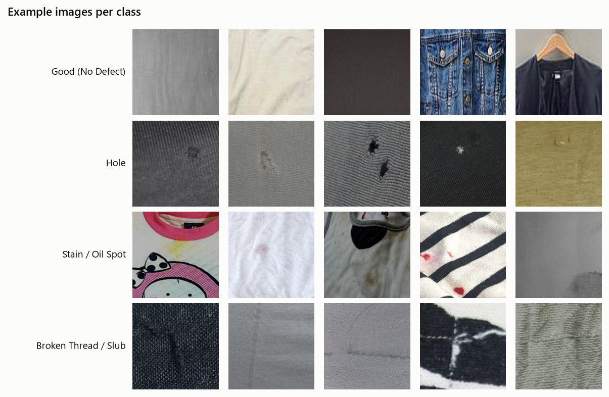
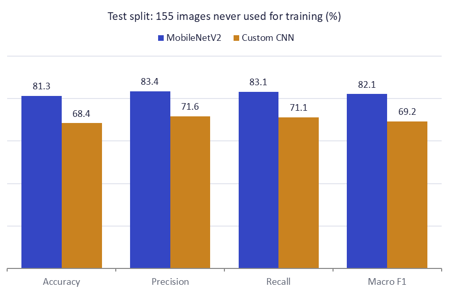
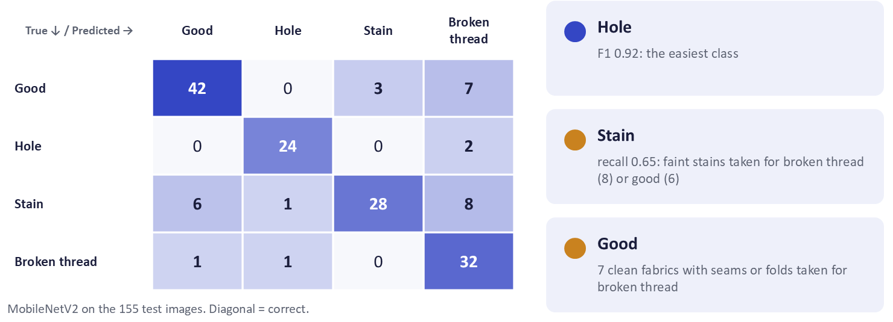
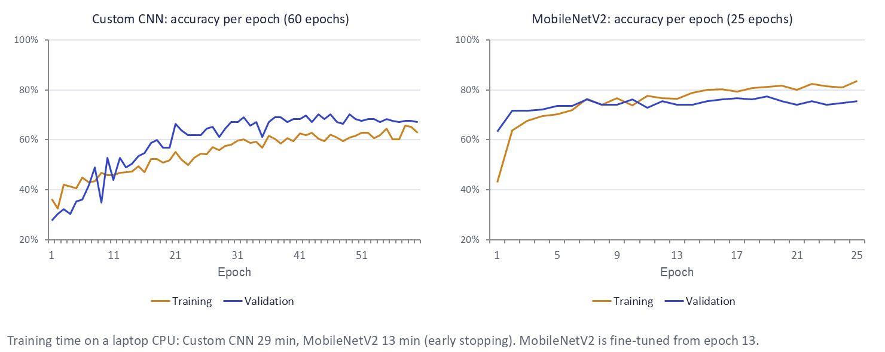

# FabricScan AI: Fabric Defect Detection with an Automatic Inspection Report

**Deep Learning semester project** · Hamza · Superior University, Gold Campus · Instructor: Dr. Munir Ahmed · 2026

**Live website:** https://fabricscan-ai.vercel.app · **Code, dataset and weights:** https://github.com/hamzaDeploys/fabricscan-ai

---

## Abstract

FabricScan AI classifies a photo of fabric or a garment into four classes (good, hole, stain, broken thread), locates
the defect, estimates its size and severity, and writes a short inspection report with likely causes and a recommended
action. A dataset of 1,025 images was built from five public Kaggle datasets, cleaned, de-duplicated and split by
source image. Two convolutional neural networks were trained on the same data: a custom CNN from scratch and a
MobileNetV2 with transfer learning. On a held-out test set of 155 images, MobileNetV2 reaches **81.3 % accuracy and
a macro F1 score of 0.82**, against 68.4 % and 0.69 for the custom CNN. Testing with real camera photos exposed two
shortcuts the model had learned from the data ("a photo of a shirt = stain" and "plain grey cotton = stain"); both
were fixed in the data, and on 150 unseen photos of clean, worn garments the final model classifies 92 % correctly as
good. The model is exported to ONNX and runs entirely in the browser in a React web application deployed on Vercel.

## 1. Problem statement

Fabric inspection in the textile and garment industry is still done mostly by eye. It is slow, tiring and depends on
the inspector, and defects that are missed come back as complaints, rework and waste. The question of this project
is whether a small neural network can automate the first step of an inspection from a single phone photo: is the
fabric defective, what kind of defect is it, where is it, and how serious is it?

## 2. Objectives

1. Build a labelled image dataset of the four classes from public sources, with a documented origin and licence for
   every image and a split without leakage between training and test data.
2. Train and compare a CNN trained from scratch with a transfer-learning model.
3. Turn the prediction into an inspection report: location, affected area, severity, causes and action.
4. Deploy the best model as a website that needs no server, and publish the code, data and weights.

## 3. Dataset

### 3.1 Classes

| Class | Definition |
|---|---|
| Good | Defect-free fabric: plain, printed, striped or textured, including normal seams, folds and wrinkles |
| Hole | A compact opening through the fabric where the surface underneath shows through |
| Stain | A foreign substance or discolouration: oil, grease, food, ink, rust, dye transfer, bleach spots |
| Broken thread | A missing, broken, pulled or snagged yarn, or a thick uneven section of yarn (slub) |

### 3.2 Sources

| Kaggle dataset | Licence | Good | Hole | Stain | Broken thread |
|---|---|---:|---:|---:|---:|
| nexuswho/fabric-defects-dataset | CC BY 4.0 | 99 | 15 | 100 | 4 |
| pulakdroy/fabric-defect-without-augmentation | CC BY 4.0 | | 157 | 43 | 121 |
| anmol055/clothes-staindefect-detection | CC BY 4.0 | 98 | | 140 | |
| hyungjung/stitchingnet-dataset | CC BY-NC 4.0 | 39 | | | 99 |
| rajkumarl/people-clothing-segmentation | CC0 | 110 | | | |
| **Total (after cleaning)** | | **346** | **172** | **283** | **224** |

`dataset/SOURCES.csv` in the repository lists the original file and licence of every image.

### 3.3 Construction

- **Detection datasets** (pulakdroy, anmol055) come with bounding boxes. Every box was cut into a square close-up two
  to three times the size of the box (at least 256 px where the image allows), so the defect stays clearly visible at
  the model's 224 px input. A crop that would also contain a box of another class was skipped, and images with more
  than six boxes of one class (dense pattern labels) were left out.
- **Clean garments:** images of anmol055 without any stain box are clean clothes; centre crops became *good*. From the
  people-clothing dataset, a square crop inside the largest upper-body garment (found with its per-pixel clothing
  mask) became *good*. These show clean shirts, tops and jackets as they are worn.
- **StitchingNet:** "broken stitch" became *broken thread* and "normal" became *good* (224 px images, upscaled to 256).
- Every image keeps a *group* (its source image), so all views of one original stay together.

### 3.4 Cleaning and split

- 1,078 imported images; **53 removed**: unreadable files, images smaller than 128 px, exact duplicates (SHA-256) and
  near duplicates (RMSE of 32 × 32 thumbnails). Images are cropped to a square, resized to 256 × 256 and stripped of
  EXIF data.
- **Group-aware split 70 / 15 / 15** (seed 42), followed by a leakage audit: no group appears in two splits. The audit
  flagged one cross-class pair at its threshold (a normal seam in *test/good* and a broken stitch from the same fabric
  in *train/broken thread*); these are different images with different labels, so it is not leakage.

| Class | Train | Val | Test | Total |
|---|---:|---:|---:|---:|
| Good | 242 | 52 | 52 | 346 |
| Hole | 120 | 26 | 26 | 172 |
| Stain | 197 | 43 | 43 | 283 |
| Broken thread | 156 | 34 | 34 | 224 |
| **Total** | **715** | **155** | **155** | **1,025** |

The largest class is twice the smallest; class weights in the loss compensate for this.



## 4. Method

### 4.1 Input and augmentation

Both models take a 224 × 224 RGB image with raw pixel values 0–255; normalisation is part of the model, so the
website and the Python scripts feed the same pixels. Training uses on-the-fly augmentation with a fixed seed: random
rotation (±15°, reflected borders), zoom (crop 80–100 %), horizontal and vertical flips, 90° turns, brightness ±20 %,
contrast ±15 % and Gaussian noise. Hue and saturation are not changed, because colour is evidence for stains.

### 4.2 Models

| | Custom CNN (from scratch) | MobileNetV2 (transfer learning) |
|---|---|---|
| Feature extractor | 4 convolution stages, 32 → 64 → 128 → 256 filters, batch normalisation, spatial dropout 0.05, L2 1e-5 | MobileNetV2 pre-trained on ImageNet |
| Head | global max pooling → dropout 0.3 → dense softmax (4) | global average pooling → dropout 0.3 → dense softmax (4) |
| Parameters | 1.18 M | 2.26 M |
| Training | Adam, learning rate 1e-3, up to 60 epochs | stage 1: backbone frozen, Adam 1e-3, 12 epochs; stage 2: top 40 layers unfrozen (batch normalisation kept frozen), Adam 1e-5, up to 20 epochs |
| Early stopping | validation loss, patience 10 | validation loss, patience 6 |

Common settings: sparse categorical cross-entropy with class weights, batch size 16, learning rate halved when the
validation loss plateaus (minimum 1e-6), best weights restored at the end, seed 42, TensorFlow 2.20 on a laptop CPU.

### 4.3 From prediction to report

The final layers of both models are a global pooling layer followed by one dense layer, so the class activation map
(CAM) of the predicted class can be computed exactly from the last feature maps and the dense weights. Both are
exported to ONNX (opset 17) with two outputs, the probabilities and the activation maps, and checked against Keras on
test images (largest difference in the probabilities about 1e-6, same predicted class for every image).

In the browser, the activation map of the predicted class is normalised and upsampled, and refined with colour
contrast against a fitted model of the surrounding fabric. This gives the defect's zone on a 3 × 3 grid, a bounding
box and the affected area in percent. Per-class area thresholds give the severity (holes are never rated below
*medium*), and a small knowledge base adds likely causes and the recommended action. Predictions below 60 %
confidence, or with the top two classes within 20 points, are marked as needing a manual check.

### 4.4 Web application and deployment

The website (React, TypeScript, Tailwind CSS, Vite) runs the ONNX model with ONNX Runtime Web (WebAssembly), so photos
are analysed on the device and never uploaded. Users can upload a photo, use the camera or pick a sample image; the
report can be copied or downloaded as PDF or PNG. The site also shows the model comparison, the dataset with a ZIP
download, and links to the code, model, report, slides and video. It is deployed on Vercel and redeployed
automatically on every push to GitHub.

## 5. Results

All numbers are on the test split: 155 images that were not used for training or for choosing the model.

| Model | Accuracy | Precision (macro) | Recall (macro) | F1 (macro) | ONNX size | CPU time / image |
|---|---:|---:|---:|---:|---:|---:|
| **MobileNetV2 (deployed)** | **81.3 %** | 83.4 % | 83.1 % | **0.821** | 8.9 MB | 12.1 ms |
| Custom CNN | 68.4 % | 71.6 % | 71.1 % | 0.692 | 4.7 MB | 5.4 ms |

Per class, MobileNetV2:

| Class | Precision | Recall | F1 | Test images |
|---|---:|---:|---:|---:|
| Good | 0.86 | 0.81 | 0.83 | 52 |
| Hole | 0.92 | 0.92 | 0.92 | 26 |
| Stain | 0.90 | 0.65 | 0.76 | 43 |
| Broken thread | 0.65 | 0.94 | 0.77 | 34 |







**Training:** the custom CNN used all 60 epochs (29 minutes) and reached a best validation accuracy of 70.3 %.
MobileNetV2 stopped early after 25 epochs (13 minutes; fine-tuning from epoch 13) with a best validation accuracy of
77.4 %.

**Field test:** `scripts/field_test.py` takes 150 photos of people wearing clean clothes that are not in the dataset
(people-clothing-segmentation), crops the garment like the training data, and runs the deployed model: **138 (92 %)
are classified as good**, 11 as stain and 1 as broken thread.

**Quick check from the repository:** `python predict.py test_samples --eval` runs the deployed ONNX model on 40
labelled test images (10 per class) and reports 82.5 % accuracy.

## 6. Discussion

**Transfer learning wins clearly.** With only 715 training images, MobileNetV2 starts from features learned on
ImageNet and is better on every metric, by 13 points of accuracy. The custom CNN still improved at epoch 60 and would
gain from longer training, but it is smaller and twice as fast.

**Errors.** Holes are recognised best. The weakest class is stain (recall 0.65): faint stains are taken for broken
threads (8 images) or good fabric (6). Broken thread has the lowest precision (0.65): 7 clean fabrics, mostly with
seams, folds or a visible weave, are taken for broken threads. These classes overlap visually at 224 px, and the
data for them comes from different cameras, which also limits generalisation.

**Shortcut learning.** The first trained model reached 82.5 % on its test set, but a clean checked shirt filmed with
a phone was classified as a stain with 99.7 % confidence. In that data, every photo of a worn garment was a stain
(from the clothes-stain dataset), so "a photo of a shirt" predicted "stain" just as well as the stain itself. Adding
clean worn garments to *good* fixed it. A second check found that 60 of 70 clean grey cotton photos were called
stain, because the grey stain photos came from one camera; adding those clean grey photos to *good* fixed that too.
The accuracies of the three training rounds (82.5 %, 85.2 %, 81.3 %) are measured on different test sets and are not
directly comparable: the final test set contains the harder cases on purpose. The lesson is that a good test score is
not enough when the training and test data share the same shortcuts; real-world checks are needed.

## 7. Problems faced and solutions

| Problem | Solution |
|---|---|
| Windows Smart App Control blocked the newest TensorFlow and SciPy DLLs | Pinned versions that run (TensorFlow 2.20, SciPy 1.16.3) in `requirements.txt` |
| A first dataset (one carpet fabric) did not match real garments | Rebuilt the dataset from five Kaggle datasets with garments, seams and fabric close-ups |
| Many defect images were tiny crops or near-black industrial shots | Box crops with context, a 128 px minimum size, and leaving out shots where the defect is not visible |
| Shortcut learning ("shirt = stain", "grey cotton = stain") | Added the missing clean examples to *good*; added a field test on unseen worn garments |
| The custom CNN stayed at chance level with global average pooling | Global max pooling and lighter regularisation (see `docs/EXPERIMENT_LOG.md`) |
| On the deployed site the model never finished loading | ONNX Runtime started its worker threads from the bundled app script, which crashes in a worker; the model now runs on one thread, and a browser test checks the deployed site |
| A `.gitignore` rule hid the website's model folder from Git | Anchored the rule to the project root before the first push |

## 8. Limitations

- Only four classes: tears, colour bleeding and other defects are unknown to the model and will be forced into one of
  the four classes.
- Stain recall (0.65) and broken-thread precision (0.65) are the weak points.
- The data comes from a few cameras and datasets; very different lighting, distance or fabrics can mislead the model.
- Location and area come from a coarse activation map plus colour contrast, so they are estimates, not measurements.

## 9. Future work

- More classes and own photos from real production, with the same group-aware split.
- Segmentation (pixel masks) for exact defect outlines and sizes.
- Longer fine-tuning, a higher input resolution and test-time augmentation.
- A camera mode that inspects video frames continuously on a production line.

## 10. Conclusion

FabricScan AI shows that a compact transfer-learning model can classify four common fabric defects from a single
photo with 81.3 % accuracy on unseen images, locate the defect and write a useful inspection note, all inside a
browser. The project also showed how easily a model learns shortcuts from its data, and that checking it with real
photos is as important as the test score.

## 11. Reproducing the results

```bash
pip install -r requirements.txt
python scripts/import_sources.py       # build dataset/ from the Kaggle downloads (see dataset/README.md)
python scripts/clean_dataset.py
python scripts/split_dataset.py
python scripts/dataset_report.py
python scripts/train_models.py --batch-size 16   # both models, ONNX export, website files, weights/
python scripts/field_test.py
python predict.py test_samples --eval
```

The published ZIP (`web/public/downloads/fabricscan-dataset.zip`) contains the exact train / val / test images, so
training can also start directly from it: `python scripts/train_models.py --splits <unzipped folder>`.

## References

1. M. Sandler, A. Howard, M. Zhu, A. Zhmoginov, L.-C. Chen. *MobileNetV2: Inverted Residuals and Linear Bottlenecks.*
   CVPR 2018.
2. B. Zhou, A. Khosla, A. Lapedriza, A. Oliva, A. Torralba. *Learning Deep Features for Discriminative Localization.*
   CVPR 2016 (class activation maps).
3. R. R. Selvaraju et al. *Grad-CAM: Visual Explanations from Deep Networks via Gradient-based Localization.* ICCV 2017.
4. Kaggle datasets: nexuswho/fabric-defects-dataset, pulakdroy/fabric-defect-without-augmentation,
   anmol055/clothes-staindefect-detection, hyungjung/stitchingnet-dataset (StitchingNet),
   rajkumarl/people-clothing-segmentation. Licences as listed in section 3.2.
5. TensorFlow / Keras, ONNX and ONNX Runtime Web, React and Vite.

*This report was written with the help of an AI assistant (Claude), as the course allows, from the project's code,
logs and measured results.*
